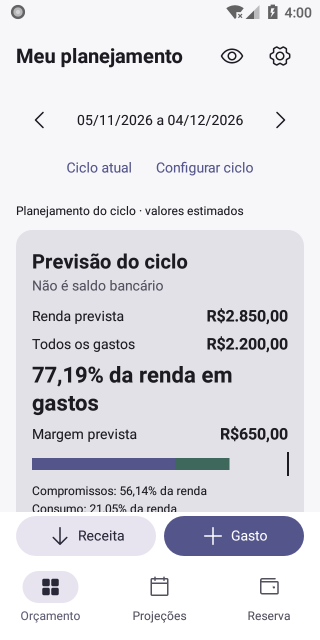

# Rendly

O Rendly organiza renda e gastos previstos por ciclo financeiro. O fluxo principal é um planejador: informa quanto se espera receber, quanto se pretende gastar e qual é a margem estimada, sem exigir confirmação de pagamentos ou recebimentos. Os dados ficam no aparelho.

## Funcionalidades

- Salário líquido previsto cadastrado uma única vez como receita mensal, compartilhado pelo orçamento e pelas projeções. Outras receitas e valores estimados usam o mesmo cadastro.
- Ajuste de uma ocorrência ou alteração daquele ciclo em diante, preservando os demais períodos.
- Cadastro único de contas recorrentes, compras parceladas, gastos únicos e estimativas de consumo. Frequência mensal e valor estimado são escolhas independentes.
- Percentual principal calculado com **todos os gastos previstos ÷ renda prevista**, incluindo compromissos e consumo variável, com déficit e percentuais acima de 100%.
- Ciclo configurável entre os dias 1 e 31, datas completas e ajuste ao último dia dos meses curtos. Renda, gastos, parcelas, gráfico e projeções usam o mesmo intervalo.
- Consulta de ciclos encerrados com renda, gastos e sobra ou déficit estimado; correções explícitas preservam as configurações futuras.
- Reserva de emergência informada pelo usuário, com saldo inicial, correções, acréscimos, retiradas, histórico e meta opcional.
- Destinação explícita de parte da sobra à reserva, sem criar despesa ou alterar o percentual de gastos.
- Projeções de seis ciclos e simulação de uma nova parcela, gravada somente ao escolher **Adotar no planejamento**.
- Modelos opcionais de gastos com valor em branco e lembretes opcionais de datas previstas, sem registrar quitação.
- Temas Sistema, Claro e Escuro, ocultação de valores e proteção opcional por biometria ou credencial do aparelho.
- Exportação CSV das previsões do ciclo e backup criptografado com prévia antes da restauração.
- Histórico original preservado para consulta, separado das novas previsões.

As regras, exemplos de cálculo e o checklist para o celular estão em [Planejador, ciclos e reserva](docs/planejador-ciclos-reserva.md).

## Como usar

Em **Orçamento**, cadastre a renda e os gastos do ciclo e escolha **Configurar ciclo** se quiser outro dia inicial. Não é necessário cadastrar conta bancária, saldo real ou configurar a captura de notificações. **Projeções** mostra o efeito dos próximos vencimentos, do término das parcelas e de uma simulação. **Reserva** reúne o valor informado e suas alterações.

Com início no dia 5, o ciclo de **05/11/2026 a 04/12/2026** inclui uma conta prevista para 02/12. Em 05/12 começa o próximo ciclo; a passagem da data não registra pagamento, recebimento, dívida ou movimentação da reserva. A margem é uma estimativa do orçamento e não representa saldo bancário.

## Dados anteriores e recuperação

A atualização preserva lançamentos, contas, pendências, recorrências, parcelas, vínculos e configurações anteriores. O aproveitamento para o planejador mantém a origem dos itens e usa os vínculos existentes para evitar somar novamente a mesma ocorrência. Rendas de referência antigas ficam disponíveis em **Projeções → Rendas de referência antigas** para revisão manual; não são somadas automaticamente ao salário. O histórico original está disponível em **Orçamento → Histórico e dados anteriores → Consultar lançamentos anteriores**.

A captura e a revisão de notificações pertencem ao fluxo anterior e não são necessárias para usar o planejador. Seu histórico técnico e as limitações dos exemplos sintéticos permanecem em [Validação bancária](docs/validacao-bancaria.md). As regras anteriores de contas e saldos estão documentadas em [Contas e saldos](docs/contas-saldos-projecoes.md).

O banco instalado utiliza Room 10. O backup inclui as previsões versionadas, ajustes por ocorrência, regras de ciclo, eventos e meta da reserva, além de todos os dados anteriores e preferências de apresentação. O conteúdo utiliza a versão 7 e lê as versões 1 a 6; o envelope criptográfico continua na versão 1, com AES-256-GCM e chave derivada da senha com PBKDF2-HMAC-SHA256. A restauração exige a senha original e confirmação antes de substituir os dados locais. Consulte [Backup e recuperação](docs/backup.md).

## Privacidade

O processamento e o armazenamento ocorrem no aparelho. O aplicativo não solicita credenciais bancárias nem acessa o extrato completo. A reserva e os valores previstos são informados pelo usuário; não há integração bancária, conciliação automática ou sincronização em nuvem.

A exportação CSV e o backup ocorrem para um destino escolhido pelo usuário. A senha do backup não é salva no aplicativo. Consentimento, permissões e configurações de segurança do aparelho não são transferidos pelo arquivo. Os backups automáticos do sistema estão desativados, e a exclusão dos dados locais está disponível em Ajustes.

A proteção opcional exige autenticação do aparelho ao iniciar e após 30 segundos em segundo plano. A opção de proteger a imagem no seletor também bloqueia capturas de tela quando respeitada pelo Android. Esse bloqueio da interface não acrescenta criptografia ao banco Room. Consulte [Privacidade](docs/privacidade.md).

## Organização técnica

A base utiliza Kotlin, Jetpack Compose, Material 3, Room/SQLite, Coroutines e StateFlow. O módulo `core` concentra as regras de dinheiro, ciclos, previsões e reserva; o módulo `app` reúne interface, persistência e integração com o Android. Os valores monetários são armazenados em centavos inteiros.

O planejador utiliza regras versionadas e ajustes por ocorrência sobre intervalos com início inclusivo e fim exclusivo. Orçamento e Projeções compartilham o mesmo cálculo; simulações usam dados temporários. O importador conserva a procedência dos itens antigos e não altera as tabelas de origem. Os componentes do fluxo anterior mantidos para regressão usam um host de testes apenas em debug, sem constituir um caminho do produto.

## Qualidade

O novo planejador passou em **203 testes do core**, **28 cenários instrumentados distintos na API26** e **219 testes instrumentados na API35**. Os builds debug, AndroidTest, preview e release, os lints e a atualização completa por APK anterior e backup criptografado também passaram. O último lint debug local terminou com zero erros e oito avisos. A verificação da instalação paralela do preview foi ajustada para conferir a nova tela de planejamento e passou localmente; consulte os checks do PR17 para o resultado completo do CI. Os cenários, evidências e limites estão em [Validação do planejador, ciclos e reserva](docs/validacao-planejador-ciclos-reserva.md).

Os números e links restantes desta seção registram validações anteriores ao novo planejador.

A validação combina testes Kotlin, persistência Room, migrações, fluxos de interface e atualização sobre a versão anterior. A validação atual está concentrada na API 35; as execuções anteriores em outras APIs permanecem documentadas. Os resultados e as limitações de cada execução ficam registrados em [Qualidade e validação](docs/qualidade.md). As novas interações e o sistema de temas são descritos em [Revisão visual](docs/redesign.md).

A [execução da revisão visual](https://github.com/Mateus1804/controle-financeiro-android/actions/runs/40209636647) aprovou 104 testes do core, 95 testes instrumentados na API 35 e as duas fases de atualização e recuperação. O lint debug e release concluiu sem erros, com 14 avisos anteriores por variante. TalkBack manual, biometria no aparelho e notificações bancárias reais permanecem fora dessa validação.

A revisão de competências mensais, interface compacta e ícone Rendly está descrita em [Validação de recorrências e Rendly](docs/validacao-recorrencias-rendly.md), com checklist para o celular e evidências desta execução.

As verificações desta integração estão em [Validação de contas e saldos](docs/validacao-contas-saldos.md).

## Interface e estágio do projeto

A versão **0.2.0** está em desenvolvimento. A navegação principal reúne **Orçamento**, **Projeções** e **Reserva**, com edição no contexto do ciclo e detalhes progressivos. As capturas da [Revisão visual](docs/redesign.md) e os relatos anteriores documentam a interface de lançamentos que antecedeu este planejador; não representam suas telas atuais.

Exemplo fictício após ajustar o salário somente neste ciclo, em uma tela de 320 × 640.

O APK da variante **preview** usa o identificador separado `com.mateuswilliam.financas.teste`, permitindo uma instalação de teste junto ao aplicativo principal. Ele tem dados próprios e não atualiza a instalação principal. Use dados fictícios para o checklist de [Planejador, ciclos e reserva](docs/planejador-ciclos-reserva.md).

Os resultados locais e os limites da entrega estão em [Validação do planejador](docs/validacao-planejador-ciclos-reserva.md). Notificações bancárias reais, TalkBack manual e biometria em aparelho continuam sujeitos à conferência específica.

## Atualizações e preservação do histórico

A preparação de atualizações passou a prever assinatura externa ao repositório, conferência de certificado e versionamento crescente. O esquema Room 4 acrescenta índices e conserva os dados existentes. O histórico e os candidatos manuais compartilham a mesma emissão, enquanto o catálogo utiliza uma consulta reduzida de nomes e datas.

A validação inclui um backup congelado no formato 1, migração dos esquemas anteriores, histórico fictício de cinco mil registros e um cenário de atualização do APK anterior sobre a instalação existente. A revisão funcional anterior cobriu as APIs 26, 33, 35 e 36; o CI atual concentra os cenários na API 35. Os resultados efetivamente executados ficam em [Qualidade](docs/qualidade.md).

A [documentação de atualizações](docs/atualizacoes.md) descreve assinatura e limitações. As amostras bancárias reais continuam pendentes; uma tarefa privada foi preparada para conferi-las sem publicar mensagens ou dados pessoais. A preparação não publica APKs nem altera a assinatura de instalações pessoais.

Na [validação funcional de 25/10/2026](https://github.com/Mateus1804/controle-financeiro-android/actions/runs/40202162302), passaram 104 testes do core e 81 testes em cada uma das APIs 26, 33, 35 e 36, sem testes ignorados. A atualização sobre o APK anterior e a recuperação de um backup produzido por ele também passaram. O Android Lint terminou sem erros nas variantes debug e release, mantendo 14 avisos anteriores em cada uma.

Os [registros de qualidade](docs/qualidade.md) distinguem validação automatizada, inspeção de capturas e limitações. Notificações bancárias reais e preparação com a chave definitiva continuam pendentes. Não houve publicação ou acesso a dados financeiros pessoais.

## Identidade Mist Teal

Rendly utiliza uma paleta própria em creme, menta e teal, com temas Sistema, Claro e Escuro. A aparência acompanha o aparelho quando Sistema está selecionado; cores dinâmicas não substituem a identidade.

Em Ajustes, **Como você quer ser chamado?** permite informar, editar ou apagar um nome opcional de até 40 caracteres. A saudação é atualizada imediatamente. Essa preferência fica no aparelho e não integra o backup. Resultado do mês corresponde à diferença entre receitas e despesas previstas do ciclo selecionado, sem representar saldo bancário.

A [renomeação do repositório](docs/renomeacao-rendly.md) está preparada para uma etapa posterior à revisão e autorização. Os identificadores Android e os dados existentes permanecem compatíveis.

Na primeira abertura, o nome pode ser informado ou adiado em **Agora não**. A pergunta é apresentada uma vez; o nome pode ser alterado nos Ajustes. A saudação inclui 👋🏼. Os cards das previsões permitem tocar no lançamento para editar e mantêm ações de recorrência no menu.
