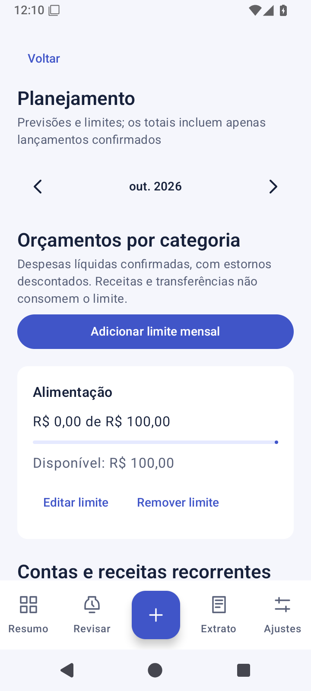
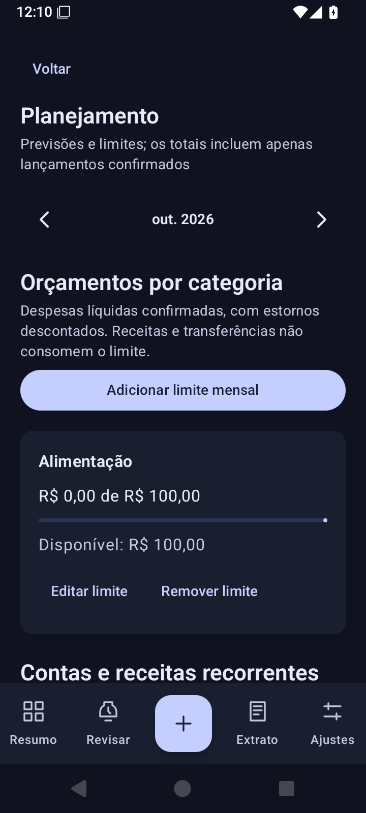

# Controle Financeiro Android

O Controle Financeiro Android permite acompanhar receitas e despesas com menos digitação e mais clareza. O projeto reúne dados locais, revisão de movimentações e uma interface simples em português para o controle financeiro do dia a dia.

## Funcionalidades

- Registro manual de receitas, despesas, transferências e estornos.
- Entrada monetária com centavos automáticos: a digitação de `1234` exibe `R$ 12,34`. O campo também aceita a colagem de valores formatados em reais.
- Cadastro e pesquisa de contas reutilizáveis, com opções recentes e aproveitamento dos nomes presentes no histórico.
- Edição e exclusão de lançamentos confirmados.
- Caixa de revisão para notificações, com valor, origem, movimentação, meio de pagamento e categoria editáveis.
- Captura opcional dos aplicativos selecionados, após consentimento e autorização do Android.
- Resumo mensal, comparação de receitas e despesas e barras de gastos por categoria.
- Gráfico de rosca das despesas brutas por categoria, conta ou meio de pagamento, com detalhamento e estornos indicados separadamente.
- Busca e filtros no histórico, navegação por mês e exportação CSV.
- Escolha persistente entre os temas Sistema, Claro e Escuro em Ajustes, além da opção de ocultar totais.
- Apresentação inicial da captura opcional e avisos de configuração que podem ser fechados, mantendo o cadastro manual disponível.
- Backup criptografado com senha e formato versionado, com prévia e conferência em banco temporário antes da restauração.
- Avisos de possível duplicidade entre lançamentos manuais e novas pendências, sem união ou exclusão automática.
- Revisão em sequência com progresso e oferta de acesso ao próximo item, preservando a edição quando chegam novas notificações.
- Orçamentos mensais por categoria e previsões recorrentes, com confirmação manual de cada vencimento.
- Lembretes opcionais de vencimentos e proteção opcional por biometria ou credencial do aparelho.

## Captura e revisão de notificações

A captura não depende de uma lista fechada de bancos. A seleção apresenta aplicativos com ícone de abertura disponíveis no mesmo perfil do Android. A origem informada pelo sistema identifica o aplicativo, e a interpretação do texto disponível sugere os demais campos.

A implementação inicial reconhece padrões genéricos em português e valores em reais. O reconhecimento é uma sugestão: mensagens ambíguas continuam pendentes, e nenhuma notificação entra nos totais sem confirmação. O tipo de movimentação (receita, despesa, transferência ou estorno), o meio de pagamento (Pix, cartão, boleto etc.) e a categoria (alimentação, moradia etc.) são campos separados.

Com o aplicativo aberto, a revisão ocorre em um formulário. Fora dele, um alerta abre a pendência ao ser tocado, desde que o envio de alertas esteja autorizado. O lançamento manual permanece disponível quando uma notificação não chega ou não contém informações suficientes.

As possíveis duplicidades consideram valor, tipo, proximidade de data, origem e descrição. Contas diferentes do mesmo banco podem representar movimentações legítimas; a indicação é apenas um apoio à conferência. Uma atualização da notificação mantém os campos editados e exige conferência explícita da nova versão.

Os casos reproduzíveis e a situação de Inter, Nubank, PicPay, Mercado Pago e PagBank estão registrados em [Validação bancária](docs/validacao-bancaria.md). Os exemplos sintéticos não constituem homologação de notificações reais.

## Planejamento e recuperação

Os limites mensais acompanham despesas líquidas confirmadas por categoria. Previsões recorrentes permanecem separadas dos lançamentos: cada vencimento pode ser conferido, registrado ou pulado. Os lembretes dependem da autorização de alertas e das condições de execução do Android, sem garantia de horário exato.

O backup inclui lançamentos, pendências, contas, orçamentos, recorrências e preferências de apresentação. O arquivo utiliza AES-256-GCM e uma chave derivada da senha com PBKDF2-HMAC-SHA256. A recuperação exige a senha original e confirmação antes de substituir os dados locais. Consentimento, permissões e configurações de segurança do aparelho não são transferidos pelo arquivo. O formato e os limites estão descritos em [Backup e recuperação](docs/backup.md).

## Privacidade

O processamento e o armazenamento dos dados ocorrem no aparelho. As origens selecionadas são filtradas antes da leitura do conteúdo; mensagens identificadas como autenticação são descartadas. O texto original é apagado após a confirmação ou o descarte da pendência. Identificadores locais evitam o reprocessamento do mesmo evento.

O aplicativo não solicita credenciais bancárias. A exportação CSV e o backup criptografado ocorrem somente para um destino escolhido pelo usuário. A senha do backup não é salva no aplicativo. Os backups automáticos do sistema estão desativados nesta versão, e a exclusão dos dados locais está disponível em Ajustes.

A proteção opcional exige autenticação do aparelho ao iniciar e após 30 segundos em segundo plano. A opção de proteger a imagem no seletor também bloqueia capturas de tela quando respeitada pelo Android. Esse bloqueio da interface não acrescenta criptografia ao banco Room.

O tratamento dos dados está descrito em [Privacidade](docs/privacidade.md).

## Organização técnica

A base utiliza Kotlin, Jetpack Compose, Material 3, Room/SQLite, Coroutines e StateFlow. O módulo `core` concentra as regras de dinheiro, interpretação e totais; o módulo `app` reúne interface, persistência e integração com o Android.

Os valores monetários são armazenados em centavos inteiros. Transferências ficam fora do resultado mensal, e estornos reduzem as despesas líquidas. A confirmação de uma pendência e a criação do lançamento ocorrem na mesma transação do banco de dados. Os gráficos apresentam despesas brutas e indicam os estornos separadamente. O cadastro de contas e a validação de transferências utilizam a mesma normalização de nomes.

## Qualidade

A execução de referência aprovou **102 testes Kotlin e 76 testes instrumentados no Android 15**, sem testes pulados. O Android Lint concluiu com zero erros e 14 avisos documentados. A validação abrange persistência e fluxos de interface. A cobertura inclui valores monetários, contas, migrações, relatórios, consentimento, confirmação simultânea, criptografia, restauração, planejamento e revisão em sequência. Os casos bancários distinguem procedência sintética de coleta real anonimizada.

Os resultados dos comandos, as execuções aprovadas, os avisos e as verificações ainda pendentes estão registrados em [Qualidade e validação](docs/qualidade.md). A validação com bancos reais, a autenticação no aparelho e a recuperação em condições reais de uso exigem avaliação própria.

## Interface

As capturas utilizam dados fictícios para demonstrar os temas, os relatórios, o planejamento e a revisão de movimentações. Foram obtidas no emulador Android 15 durante a validação desta revisão; a origem das imagens está documentada em [Qualidade e validação](docs/qualidade.md).

| Resumo claro | Resumo escuro |
| --- | --- |
|  |  |

| Relatório por categoria | Revisão da notificação |
| --- | --- |
|  |  |

| Planejamento claro | Planejamento escuro |
| --- | --- |
|  |  |

| Possível duplicidade | Revisão em sequência |
| --- | --- |
|  |  |

## Estágio do projeto

A versão **0.1.0** está em desenvolvimento, com a base de registro e revisão disponível. Os padrões são validados com exemplos sintéticos; a conferência de notificações reais de cada aplicativo bancário e do comportamento dos aparelhos permanece pendente.

A captura não equivale a uma integração oficial com os bancos ou ao acesso ao extrato completo. Contas com saldo inicial, conciliação, faturas, parcelamentos, metas e sincronização em nuvem continuam fora desta etapa, conforme o [planejamento](docs/planejamento.md). Os valores apresentados representam lançamentos registrados, sem promessa de saldo bancário conciliado.

Os resultados efetivamente executados estão registrados em [Qualidade e validação](docs/qualidade.md), junto às [decisões técnicas](docs/decisoes.md) e às [referências de estudo](docs/referencias.md). As instruções do ambiente e os comandos ficam no [guia de desenvolvimento](docs/desenvolvimento.md).

## Atualizações e preservação do histórico

A preparação de atualizações passou a prever assinatura externa ao repositório, conferência de certificado e versionamento crescente. O esquema Room 4 acrescenta índices e conserva os dados existentes. O histórico e os candidatos manuais compartilham a mesma emissão, enquanto o catálogo utiliza uma consulta reduzida de nomes e datas.

A validação inclui um backup congelado no formato 1, migração dos esquemas anteriores, histórico fictício de cinco mil registros e um cenário de atualização do APK anterior sobre a instalação existente. A matriz de emuladores cobre APIs 26, 33 e 35. Os resultados efetivamente executados ficam em [Qualidade](docs/qualidade.md).

A [documentação de atualizações](docs/atualizacoes.md) descreve assinatura e limitações. As amostras bancárias reais continuam pendentes; uma tarefa privada foi preparada para conferi-las sem publicar mensagens ou dados pessoais. A preparação não publica APKs nem altera a assinatura de instalações pessoais.
