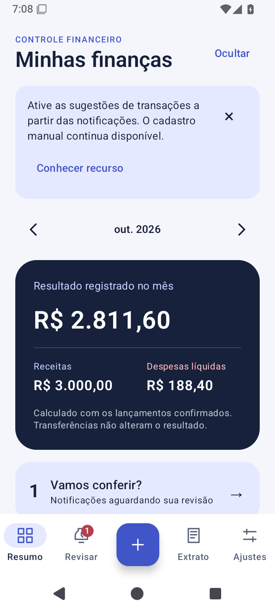
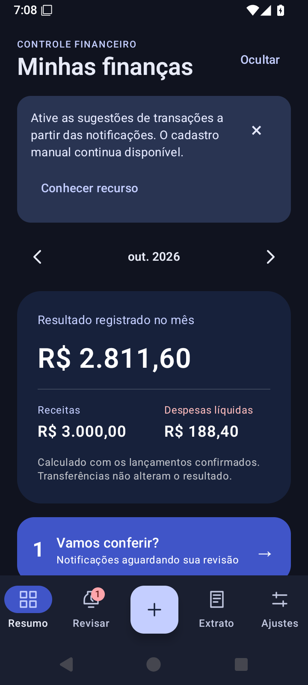
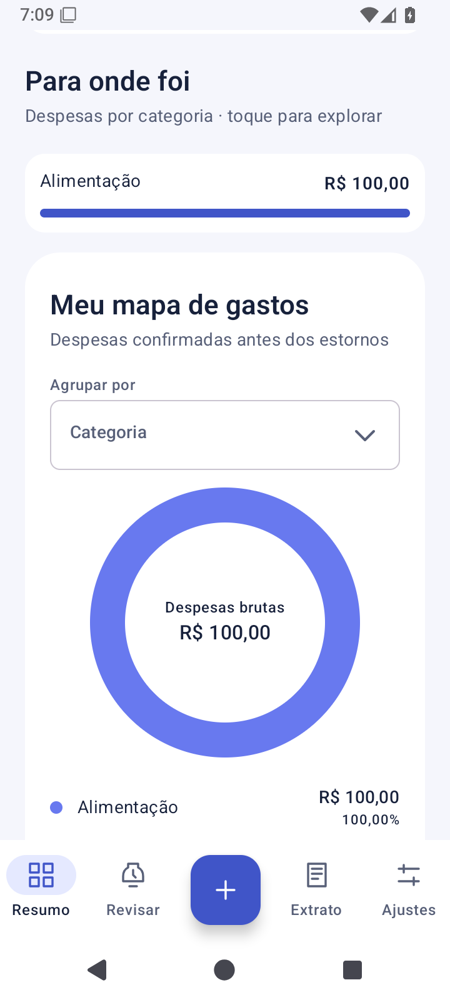
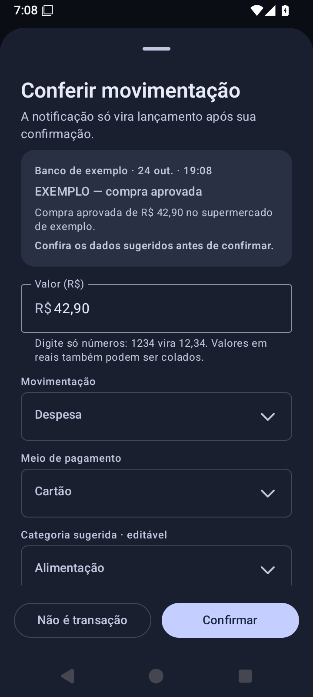

# Controle Financeiro Android

O Controle Financeiro Android permite acompanhar receitas e despesas com menos digitação e mais clareza. O projeto reúne dados locais, revisão de movimentações e uma interface simples em português para o controle financeiro do dia a dia.

## Funcionalidades

- Registro manual de receitas, despesas, transferências e estornos.
- Entrada monetária com centavos automáticos: a digitação de `1234` exibe `R$ 12,34`. O campo também aceita a colagem de valores formatados em reais.
- Cadastro e pesquisa de contas reutilizáveis, com opções recentes e aproveitamento dos nomes presentes no histórico.
- Edição e exclusão de lançamentos confirmados.
- Caixa de revisão para notificações, com valor, origem, movimentação, meio de pagamento e categoria editáveis.
- Captura opcional dos aplicativos selecionados, após consentimento e autorização do Android.
- Resumo mensal, comparação de receitas e despesas e barras de gastos por categoria.
- Gráfico de rosca das despesas brutas por categoria, conta ou meio de pagamento, com detalhamento e estornos indicados separadamente.
- Busca e filtros no histórico, navegação por mês e exportação CSV.
- Escolha persistente entre os temas Sistema, Claro e Escuro em Ajustes, além da opção de ocultar totais.
- Apresentação inicial da captura opcional e avisos de configuração que podem ser fechados, mantendo o cadastro manual disponível.

## Captura e revisão de notificações

A captura não depende de uma lista fechada de bancos. A seleção apresenta aplicativos com ícone de abertura disponíveis no mesmo perfil do Android. A origem informada pelo sistema identifica o aplicativo, e a interpretação do texto disponível sugere os demais campos.

A implementação inicial reconhece padrões genéricos em português e valores em reais. O reconhecimento é uma sugestão: mensagens ambíguas continuam pendentes, e nenhuma notificação entra nos totais sem confirmação. O tipo de movimentação (receita, despesa, transferência ou estorno), o meio de pagamento (Pix, cartão, boleto etc.) e a categoria (alimentação, moradia etc.) são campos separados.

Com o aplicativo aberto, a revisão ocorre em um formulário. Fora dele, um alerta abre a pendência ao ser tocado, desde que o envio de alertas esteja autorizado. O lançamento manual permanece disponível quando uma notificação não chega ou não contém informações suficientes.

## Privacidade

O processamento e o armazenamento dos dados ocorrem no aparelho. As origens selecionadas são filtradas antes da leitura do conteúdo; mensagens identificadas como autenticação são descartadas. O texto original é apagado após a confirmação ou o descarte da pendência. Identificadores locais evitam o reprocessamento do mesmo evento.

O aplicativo não solicita credenciais bancárias. A exportação CSV ocorre somente para um destino escolhido pelo usuário. Os backups automáticos do sistema estão desativados nesta versão, e a exclusão dos dados locais está disponível em Ajustes.

O tratamento dos dados está descrito em [Privacidade](docs/privacidade.md).

## Organização técnica

A base utiliza Kotlin, Jetpack Compose, Material 3, Room/SQLite, Coroutines e StateFlow. O módulo `core` concentra as regras de dinheiro, interpretação e totais; o módulo `app` reúne interface, persistência e integração com o Android.

Os valores monetários são armazenados em centavos inteiros. Transferências ficam fora do resultado mensal, e estornos reduzem as despesas líquidas. A confirmação de uma pendência e a criação do lançamento ocorrem na mesma transação do banco de dados. Os gráficos apresentam despesas brutas e indicam os estornos separadamente. O cadastro de contas e a validação de transferências utilizam a mesma normalização de nomes.

## Qualidade

A revisão da interface foi validada com **51 testes de regras Kotlin** e **41 testes instrumentados no Android 15**, todos aprovados. A cobertura inclui valores monetários, contas, migração, relatórios, consentimento, persistência, confirmação simultânea e fluxos de interface. Também foram verificados recriação do formulário, fonte ampliada, orientação horizontal e concessão e revogação do acesso às notificações.

Os APKs foram compilados, o Android Lint foi executado sem erros e as permissões do manifesto mesclado foram conferidas. Os avisos, as evidências e os limites da avaliação estão registrados em [Qualidade e validação](docs/qualidade.md).

## Interface

As capturas utilizam dados fictícios para demonstrar os temas, os relatórios e a revisão de movimentações. Foram registradas antes da revisão editorial dos títulos e textos do aplicativo; a origem das imagens está documentada em [Qualidade e validação](docs/qualidade.md).

| Resumo claro | Resumo escuro |
| --- | --- |
|  |  |

| Relatório por categoria | Revisão da notificação |
| --- | --- |
|  |  |

## Estágio do projeto

A versão **0.1.0** está em desenvolvimento, com a base de registro e revisão disponível. Os padrões são validados com exemplos sintéticos; a conferência de notificações reais de cada aplicativo bancário e do comportamento dos aparelhos permanece pendente.

A captura não equivale a uma integração oficial com os bancos ou ao acesso ao extrato completo. Contas com saldo inicial, conciliação, faturas, parcelamentos, orçamentos, recorrências e backup restaurável fazem parte do [planejamento](docs/planejamento.md).

Os resultados efetivamente executados estão registrados em [Qualidade e validação](docs/qualidade.md), junto às [decisões técnicas](docs/decisoes.md) e às [referências de estudo](docs/referencias.md). As instruções do ambiente e os comandos ficam no [guia de desenvolvimento](docs/desenvolvimento.md).
