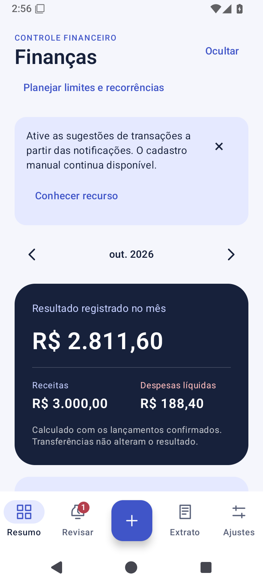
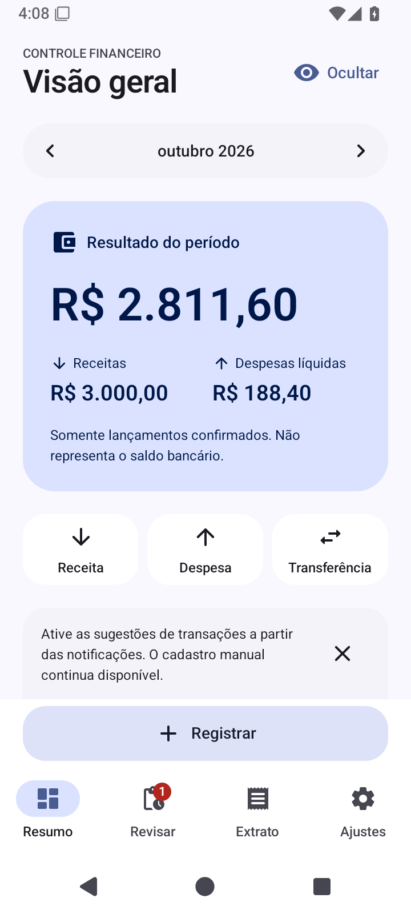
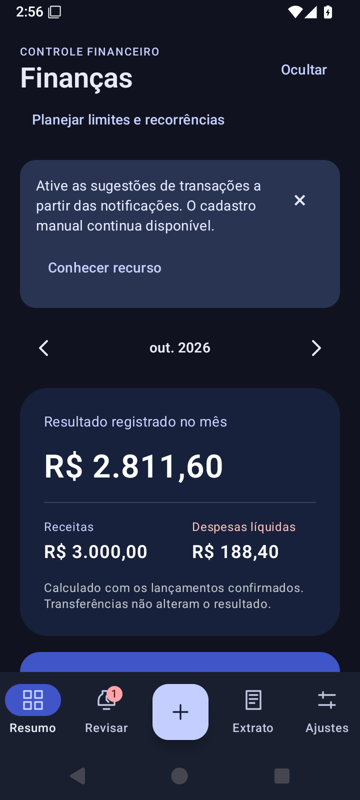
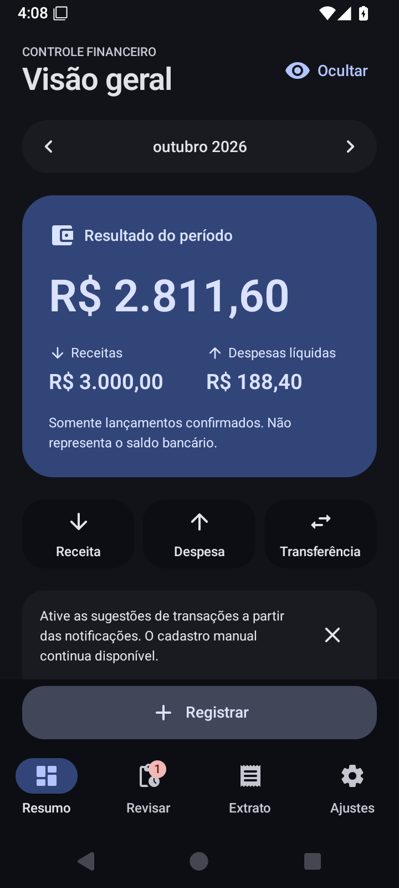

# Revisão visual — outubro de 2026

## Escopo

A revisão reorganiza a apresentação do aplicativo sem modificar o esquema Room 4, as migrações, o formato de backup, os cálculos em centavos, a captura opcional nem as regras de confirmação. A referência anterior é a árvore `bfc3398fb615d6e2605c0c401f3d9c35f5548ab3`, integrada em `f7b2f945`.

A simplicidade visual de aplicativos financeiros como Spendee orienta o uso de espaço, agrupamentos e tipografia. Os cartões de resumo seguem a ideia de uma superfície tonal destacada, como no Google Wallet, com implementação própria em Compose. Não são reutilizados marca, imagens, layouts proprietários ou código desses produtos.

## Sistema visual

- `Theme.kt` centraliza paletas, tipografia, formas, espaçamentos e cores semânticas.
- Android 12 ou superior utiliza `dynamicLightColorScheme` e `dynamicDarkColorScheme`. A escolha persistente Sistema, Claro ou Escuro continua determinando a luminosidade. A cor de destaque acompanha o aparelho.
- Android 8 a 11 utiliza paletas próprias: fundos neutros, destaque violeta moderado, verde para receitas e terracota para despesas. Transferências e estornos têm nomes e ícones distintos, além da cor.
- Os grupos usam superfícies tonais sem elevação; o cartão principal tem cantos de 28 dp. O formulário e as ações compartilham formas e espaçamentos.
- A tipografia utiliza a família nativa, com números tabulares. Valores longos usam `BasicText` e `TextAutoSize`, disponíveis nas dependências instaladas, com quebra em até duas linhas. Nenhum cálculo financeiro é convertido para ponto flutuante.
- Os quatro destinos permanecem na `NavigationBar`. A ação de novo lançamento ocupa uma faixa própria acima da navegação no `Scaffold`, sem sobreposição ao histórico ou aos avisos. O espaçamento do conteúdo considera toda essa área fixa.
- O gráfico usa Canvas, sem nova biblioteca. A agregação permanece em `core`; proporções de desenho não alteram os valores em centavos. A lista textual continua acessível. A transição discreta de opacidade utiliza o suporte de animação do Compose e a escala de duração do sistema.

## Telas e interações

O resumo destaca **Resultado do período**, calculado somente a partir de lançamentos confirmados. A legenda esclarece que esse valor não representa um saldo bancário conciliado. As ações Receita, Despesa e Transferência abrem o mesmo editor com o tipo correspondente, sem criar registros antecipadamente.

O histórico utiliza `ListItem`, com ícones de categoria, conta, data, tipo e valor. As linhas formam superfícies agrupadas sem divisórias. Em fontes ampliadas, o valor passa para baixo das informações, preservando espaço para a descrição.

Pendências, planejamento, contas reutilizáveis, apresentação inicial, ajustes e diálogos compartilham o mesmo vocabulário visual. O consentimento continua explícito; ocultar um aviso não concede autorização. A previsão recorrente permanece separada dos lançamentos confirmados.

## Ocultação de valores

A ocultação abrange totais, legendas, percentuais, textos originais de notificações e descrições que contenham valores em reais. A máscara de texto é exclusivamente de apresentação: não modifica as informações armazenadas. Datas e contagens não são ocultadas indiscriminadamente.

Com a ocultação ativa, o campo de valor só aparece após a ação explícita **Mostrar valor para edição**. Uma descrição que contenha valores também exige revelação local. O formulário pode ocultá-los novamente, sem alterar a preferência global. Exportações e backups mantêm os dados originais por serem ações explícitas de transferência e recuperação.

Com a ocultação ativa, a rosca utiliza um anel neutro e as barras de proporção não são desenhadas. Esses elementos decorativos não divulgam valores ou proporções pelo leitor de tela. A legenda textual identifica cada grupo sem depender exclusivamente de cor.

## Ícones e dependências

São utilizados vetores oficiais **Google Material Icons Round**, convertidos de SVG para VectorDrawable. A fonte foi fixada na revisão `10ecc14790612ca8fd164e3f4ffe9c16fc50d5b7`. Os caminhos e a licença Apache-2.0 estão registrados em [icones-material.json](icones-material.json), [avisos de terceiros](../THIRD_PARTY_NOTICES.md) e `licenses/material-icons-LICENSE.txt`.

Não foram adicionadas dependências de execução nem atualizadas as versões de Kotlin, Compose, Material 3 ou Room. A fonte e as imagens não exigem acesso à rede.

## Critérios de aceite

A revisão verifica atalhos com o tipo correto, manutenção de centavos inteiros, filtro e edição do histórico, revisão obrigatória, ocultação visual e semântica, contraste dos pares principais, alternância dos temas, valores longos e áreas de toque. A suíte funcional existente continua verificando persistência, recuperação, planejamento, consentimento e atualizações.

A [execução 40209636647](https://github.com/Mateus1804/controle-financeiro-android/actions/runs/40209636647), no commit `15ed9a498d486a2889f80001f9a33856f1f34c0f`, aprovou **104 testes do core e 95 testes instrumentados na API 35**, sem falhas ou testes ignorados. As duas fases de atualização e recuperação também passaram. Android Lint debug e release concluíram sem erros, mantendo 14 avisos anteriores por variante. Os APKs debug, de testes e release e o AAB foram compilados; a assinatura descartável de CI foi conferida. O [registro de qualidade](qualidade.md) detalha comandos, resultados e limitações.

Foram aprovadas as verificações de fonte em 200%, tela de 320 dp, teclado aberto, paisagem, contraste das paletas, navegação com alvos mínimos e leitura da última linha acima da ação fixa. A captura de tela é evidência visual; a persistência e os valores resultantes são verificados pelos testes, separadamente.

A tentativa local de `:core:test :app:lintDebug :app:assembleDebug` foi interrompida antes dos testes, pois a distribuição Gradle 8.13 não estava acessível pelo ambiente. Isso não constitui aprovação nem reprovação do aplicativo.

## Capturas e procedência

As capturas anteriores foram extraídas do artefato `evidencias-android-35-suite` da [execução 40203715541](https://github.com/Mateus1804/controle-financeiro-android/actions/runs/40203715541), correspondente à árvore usada como referência. As telas de resumo usam os três lançamentos fictícios de `FinanceUiTest.screenshotsUseOnlyFictionalRecords`: receita de R$ 3.000,00 e despesas de R$ 68,50 e R$ 119,90. A pendência de R$ 42,90 permanece fora dos totais.

As capturas posteriores vieram do artefato `evidencias-android-35-suite`, ID `12605495829`, da execução aprovada `40209636647`, no mesmo commit do código validado. A [procedência](imagens/redesign/procedencia.json) registra arquivo de origem, execução, dimensões e SHA-256 de cada PNG, copiado sem edição. As imagens usam dados fictícios. Não há dados bancários pessoais. Os diálogos de senha e de restauração mantêm `FLAG_SECURE`; a ausência de captura pública desses diálogos não deve ser contornada desativando a proteção.

## Antes e depois

O resumo utiliza os mesmos valores fictícios nas duas versões. O período permanece outubro de 2026; a apresentação do mês foi expandida por legibilidade.

| Anterior · claro | Atual · claro | Anterior · escuro | Atual · escuro |
| --- | --- | --- | --- |
|  |  |  |  |

| Tela | Anterior claro | Atual claro | Anterior escuro | Atual escuro |
| --- | --- | --- | --- | --- |
| Ajustes | [Imagem](imagens/redesign/antes-ajustes-claro.png) | [Imagem](imagens/redesign/depois-ajustes-claro.png) | [Imagem](imagens/redesign/antes-ajustes-escuro.png) | [Imagem](imagens/redesign/depois-ajustes-escuro.png) |
| Planejamento | [Imagem](imagens/redesign/antes-planejamento-claro.png) | [Imagem](imagens/redesign/depois-planejamento-claro.png) | [Imagem](imagens/redesign/antes-planejamento-escuro.png) | [Imagem](imagens/redesign/depois-planejamento-escuro.png) |
| Revisão | [Imagem](imagens/redesign/antes-revisao.png) | [Imagem](imagens/redesign/depois-revisao-claro.png) | [Imagem](imagens/redesign/antes-revisao-escuro.png) | [Imagem](imagens/redesign/depois-revisao-escuro.png) |

## Outras telas e condições

| Tela | Claro | Escuro |
| --- | --- | --- |
| Extrato | [Imagem](imagens/redesign/depois-extrato-claro.png) | [Imagem](imagens/redesign/depois-extrato-escuro.png) |
| Pendências | [Imagem](imagens/redesign/depois-pendencias-claro.png) | [Imagem](imagens/redesign/depois-pendencias-escuro.png) |
| Apresentação inicial | [Imagem](imagens/redesign/depois-introducao-claro.png) | [Imagem](imagens/redesign/depois-introducao-escuro.png) |
| Fonte em 200%, tela de 320 dp | [Imagem](imagens/redesign/depois-resumo-fonte-ampliada-claro.png) | [Imagem](imagens/redesign/depois-resumo-fonte-ampliada-escuro.png) |

Também estão disponíveis o [gráfico com legenda](imagens/redesign/depois-grafico-categorias.png), o [formulário em paisagem](imagens/redesign/depois-formulario-paisagem.png) e o [formulário com teclado aberto e fonte em 200%](imagens/redesign/depois-formulario-pequeno-teclado.png). Em fontes muito ampliadas, rótulos da navegação ocupam duas linhas e o conteúdo exige mais rolagem. Isso não equivale a uma inspeção manual de TalkBack.

## Limites de validação

A validação final desta revisão está concentrada na API 35 por decisão de escopo. As primeiras passagens nas APIs 26 e 33 já haviam sido concluídas. A compatibilidade final das demais APIs não foi reexecutada. A validação em emulador não substitui TalkBack operado por uma pessoa, aparelhos de fabricantes diferentes, autenticação biométrica real ou testes com notificações bancárias recebidas. As cores dinâmicas também dependem da paleta do aparelho; os testes cobrem as paletas dos emuladores, sem certificar todos os papéis de parede.

Merge, publicação e uso da chave definitiva permanecem fora desta revisão.
