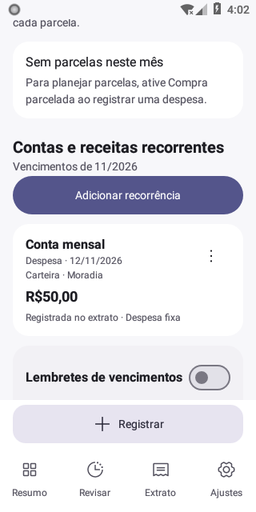

# Validação de recorrências, interface e Rendly

Esta revisão mantém o nome **Controle Financeiro**, o identificador `com.mateuswilliam.financas` e as configurações de assinatura e publicação.

## Escopo

- Separação entre a configuração recorrente e cada competência mensal.
- Edição e confirmação de vencimentos com identidade mensal estável, persistência e histórico.
- Cartões e listas compactos, ações secundárias em menus e informações opcionais expansíveis.
- Ícones internos Phosphor Regular/Fill e launcher Rendly a partir do SVG original.
- Validação de entradas recuperáveis por backup e limpeza do destino oculto ao converter transferências.

## Interface conferida

Capturas do aplicativo compilado em emulador Android 8.0/API 26, em tela de 320 × 640, com dados fictícios. Os ícones internos são Phosphor; os cartões apresentam as ações secundárias pelo menu de três pontos.

| Planejamento | Recorrência mensal |
| --- | --- |
|  |  |

Os [recursos e as prévias do Rendly](design/rendly/README.md) e a [procedência dos Phosphor Icons](icones-phosphor.md) detalham as camadas vetoriais e as licenças.

## Checklist manual no celular

Use dados fictícios em uma instalação de teste. Para atualizar uma instalação de uso pessoal, preserve a chave de assinatura e faça backup antes; não desinstale para contornar uma incompatibilidade de assinatura.

1. Abra o aplicativo nos temas claro e escuro. Confira resumo, revisão, extrato, planejamento e ajustes com fonte normal e ampliada.
2. Confira os ícones Regular nas opções inativas e Fill na opção selecionada; navegue pelas quatro abas e por Planejamento.
3. Cadastre uma despesa fixa com vencimento no dia 31. Navegue por janeiro, fevereiro, março e abril; confira o último dia de cada mês e um fevereiro bissexto.
4. Mude somente o valor ou vencimento de uma competência. Confira que os meses anterior e seguinte conservam seus dados.
5. Mude o vencimento do mesmo mês duas vezes e confirme o pagamento. Tente repetir a confirmação; deve continuar existindo um único pagamento para essa competência.
6. Confirme dezembro e confira janeiro do ano seguinte. Pular um vencimento deve afetar somente a competência escolhida.
7. Feche completamente o aplicativo e abra novamente. Confira valores, vencimentos e estados pagos, pulados e pendentes.
8. Edite a configuração recorrente com vigência futura e confira que as competências anteriores conservam o histórico.
9. Cadastre uma compra parcelada com centavos não divisíveis igualmente. Confira a soma das parcelas, o vencimento habitual e a edição/cancelamento apenas das parcelas em aberto.
10. Abra os menus de gastos fixos e parcelas; confira edição, exclusão e cancelamento. Cancele uma confirmação de exclusão e verifique que o item permanece.
11. Remova um orçamento, primeiro cancelando e depois confirmando. Confira que os lançamentos e pagamentos não mudam.
12. Edite uma transferência e converta em despesa. Confira a ausência de conta de destino no registro e no CSV.
13. Gere um backup, restaure-o em instalação de teste e confira pagamentos, previsões e ajustes mensais. Confira também um backup anterior, se disponível.
14. Confira o launcher nos formatos circular e quadrado arredondado, em tamanhos pequenos, e com ícones temáticos no Android 13+. O monograma não deve ser cortado.
15. Confira com TalkBack a navegação, as ações de cada cartão, seções expansíveis e valores ocultos. Nenhum valor oculto deve ser anunciado.

## Evidências automatizadas

As correções se concentram nas causas identificadas: projeções históricas calculadas pelo cursor global, identidade baseada no dia de vencimento, configuração futura aplicada ao mês anterior, estados de pagamento contraditórios no backup, destino oculto em despesas e alertas mensais que permaneciam após a exclusão da recorrência.

- Núcleo Kotlin: 177 testes, sem falhas, erros ou testes ignorados.
- Compilação: `assembleDebug`, `assembleDebugAndroidTest` e `assemblePreview` concluídos.
- Android Lint debug: sem erros; 16 avisos de dependências, sugestões KTX e qualificadores/monochrome do launcher. As variantes API 33 do launcher possuem a camada monocromática e são verificadas pelo script de recursos.
- Ícone: `python3 scripts/verify-rendly.py` conferiu o SVG original, quatro caminhos, cores, camadas, área segura, variantes API 26/33, dez PNGs legados e prévias de 32 px.
- Contraste: 16 pares das paletas de fallback acima de 4,5:1. Gradle Wrapper e os cinco testes do verificador de amostras bancárias passaram.
- Atualização real do APK no emulador: banco 7→8 com `integrity_check=ok` e conteúdo das dez tabelas anteriores preservado, além dos testes dedicados de migração de recorrências.
- Regressões iniciais: a versão original apresentou sete falhas esperadas em dez testes. A execução focada na versão corrigida passou nos 21 testes disponíveis naquele APK; a suíte completa usa o APK final e inclui as regressões adicionais da revisão.
- A tentativa integral descobriu 180 testes: o fluxo capturado registrou 127 aprovados e quatro falhas de interação antes de atingir o limite externo de 20 minutos. A desconexão subsequente de UiAutomation impediu um resultado integral confiável. As quatro jornadas receberam correções de interação dos testes (fechamento real do teclado do diálogo, rolagem do menu e dispensa explícita de snackbar); a repetição por classes é necessária antes de considerar a suíte completa aprovada.

O esquema Room 8 adiciona snapshots por competência e revisões com vigência mensal; o backup de dados V5 conserva esses estados e continua lendo V1–V4. Os registros legados e pagamentos adicionais de uma mesma competência são preservados. Valores históricos que já haviam sido sobrescritos pela versão antiga não podem ser reconstruídos automaticamente.

Os testes instrumentados utilizam exclusivamente emulador isolado API 26. TalkBack manual, máscaras e ícones temáticos em aparelho Android 13+, notificações bancárias reais e a suíte de atualização assinada do CI permanecem verificações separadas. Esta execução não publica APKs em lojas nem altera as configurações de assinatura.

## Fechamento das três pendências de interface

Os três casos anteriormente reprovados passaram após os ajustes: classificação de despesa fixa e jornada financeira completa foram aprovadas na execução dirigida; criação/restauração pelo seletor nativo foi aprovada separadamente em 216,222 segundos. As verificações de pagamentos, totais e restauração permaneceram intactas.

Os testes agora acionam os controles por sua semântica de clique e aguardam a composição antes de alternar para a automação nativa. Somente as esperas de preparação/conferência criptográfica usam até 300 segundos, pois o PBKDF2 com 600 mil iterações usa o provedor Java lento da API 26 sem aceleração. As iterações e a criptografia de produção não foram alteradas.

A aprovação destes três casos não equivale a uma nova execução integral dos 180 testes; o limite da tentativa integral permanece registrado acima.
